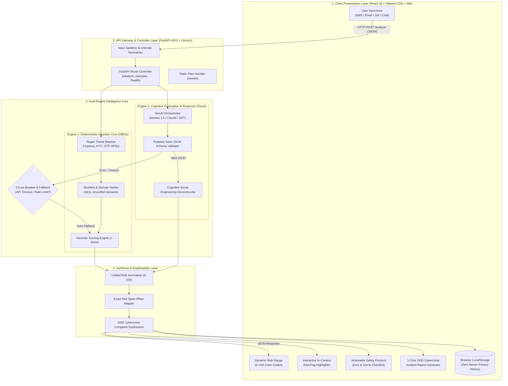

# 🏗️ PromptShield — System Architecture Specification
**Project by:** Team ByteBusters (Lead Developer: Yashwanth Pathiwada)  
**Hackathon Deliverable:** Item 4 — Architecture Diagram

---

## 📌 High-Resolution Architecture Diagram

*(The high-resolution diagram `architecture_diagram.png` is committed directly in the repository root).*

---

## 🔄 Interactive Component Architecture (Mermaid)

GitHub natively renders the flowchart below in your browser:

---

## 🧱 Architectural Layer Breakdown

### 1. Presentation Layer (React 18 + Tailwind CSS + Vite)
- Single Page Application (SPA) providing sub-second load times.
- Component-driven architecture using Lucide React icons.
- Local-first architecture: past threat scans are preserved in browser `localStorage`, ensuring zero server-side exposure of private user communications.

### 2. API Gateway & Controller Layer (FastAPI + Python 3.11)
- Asynchronous ASGI architecture powered by Uvicorn, capable of serving high-throughput concurrent requests.
- Input sanitization strips invisible zero-width characters and homoglyph lookalikes before engine evaluation.
- Serves both API endpoints (`/analyze`, `/samples`, `/health`) and mounts compiled frontend static assets (`/assets`) from a unified port.

### 3. Dual-Engine Intelligence Core
- **Engine 1 (Deterministic Heuristic):** 40+ pre-compiled regular expressions evaluating urgency triggers, financial bait, credential theft, and suspicious URL shorteners in under 50ms without external network requests.
- **Engine 2 (Cognitive GenAI Reasoner):** Multi-model support (Gemini 1.5 Flash, Claude 3.5 Sonnet, GPT-4o-mini) translating subtle manipulation patterns into structured JSON.
- **Circuit Breaker:** If a cloud AI API call experiences rate limits or times out, the system automatically degrades to the Deterministic Heuristic Core with zero user interruption.

### 4. Output Synthesis & National Defense Integration
- Normalizes disparate indicators into a unified 0–100 risk score.
- Maps extracted quotes back to character index offsets in the original text to generate interactive highlight spans.
- Formats evidence directly for India's National Cybercrime Portal (`cybercrime.gov.in`) and National Helpline (`1930`).
