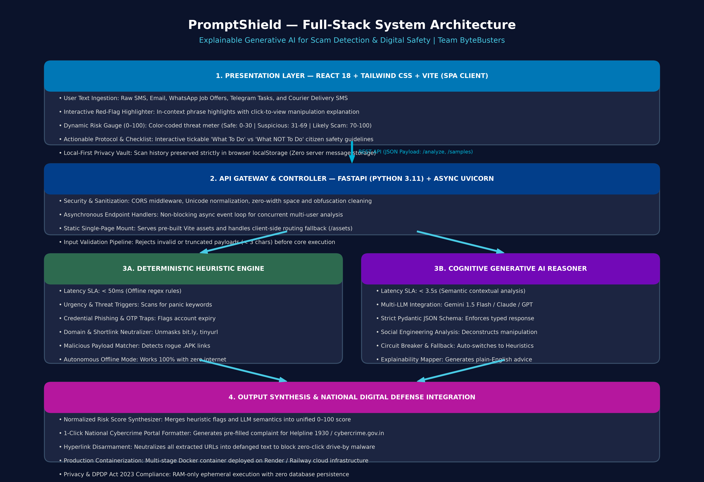
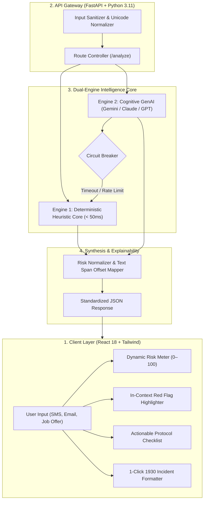

# 🛡️ PromptShield — Explainable Generative AI for Scam Detection & Digital Safety

[](https://fastapi.tiangolo.com)
[](https://react.dev/)
[](https://vitejs.dev/)
[](https://www.docker.com/)
[](https://cybercrime.gov.in)
[](#-team-bytebusters)

> **48-Hour Hackathon Master Submission:** PromptShield bridges the critical "Explainability Gap" in modern cybersecurity. Rather than offering an opaque "spam vs. not spam" tag, PromptShield empowers citizens with transparent cognitive explanations, contextual red-flag highlighting, dynamic risk metrics, actionable checklists, and official cybercrime incident reporting.

---

## 🏆 48-Hour Hackathon Deliverables Dashboard

| # | Required Deliverable | Description & Location | Status |
| :-: | :--- | :--- | :-: |
| **1** | **Complete Source Code** | Full-stack production codebase: `/backend`, `/frontend`, `/tests`, `Dockerfile` | ✅ Complete |
| **2** | **BRD / Project Documentation** | [PromptShield BRD & Business Use Cases (PDF)](PromptShield_BRD_and_Business_Use_Cases.pdf) \| [Word (.docx)](PromptShield_BRD_and_Business_Use_Cases.docx) | ✅ Complete |
| **3** | **Presentation (PPT)** | Pitch deck structure for evaluators ([Gamma Prompt & Slides Outline](#-hackathon-pitch-deck-presentation-ppt)) | ✅ Complete |
| **4** | **Architecture Diagram** | High-resolution image: [`architecture_diagram.png`](architecture_diagram.png) \| [Architecture Spec (`ARCHITECTURE.md`)](ARCHITECTURE.md) | ✅ Complete |
| **5** | **Installation Guide** | Step-by-step setup for Docker & local development: [`INSTALLATION.md`](INSTALLATION.md) | ✅ Complete |
| **6** | **Feature List** | Itemized inventory of all analytical & safety features: [`FEATURES.md`](FEATURES.md) | ✅ Complete |
| **7** | **Business Use Case** | 6 Detailed operational personas & threat scenarios: [`BUSINESS_USE_CASES.md`](BUSINESS_USE_CASES.md) | ✅ Complete |
| **8** | **Future Roadmap** | Phased growth (Browser extensions, Android SMS reader, regional voice): [`ROADMAP.md`](ROADMAP.md) | ✅ Complete |
| **9** | **README File** | This master landing page uniting all documentation and technical assets | ✅ Complete |
| **10** | **Demo Video (Optional)** | Live application walkthrough instructions & demo flow ([Demo Walkthrough](#-live-demonstration--evaluator-guide)) | ✅ Ready |

---

## 🏗️ Item 4: Architecture Diagram

PromptShield utilizes a **Dual-Engine Processing Pipeline** that combines a sub-50ms deterministic heuristic engine with cognitive Generative AI reasoning.




*(For comprehensive architectural notes, see [ARCHITECTURE.md](ARCHITECTURE.md)).*

---

## ⚡ Item 5: Quick-Start Installation Guide

For detailed steps, refer to the full [Installation Guide (`INSTALLATION.md`)](INSTALLATION.md).

### Quick Run with Docker (Recommended)
```bash
# 1. Clone the repository
git clone https://github.com/yashwanthPathiwada/promptshield-ai.git
cd promptshield-ai

# 2. Build the all-in-one container
docker build -t promptshield:latest .

# 3. Launch the container
docker run -p 8000:8000 promptshield:latest
```
Visit **`http://localhost:8000`** in your browser.

### Manual Local Run
```bash
# Terminal 1: Backend (FastAPI)
cd backend
python -m venv venv
source venv/bin/activate  # Or .\venv\Scripts\Activate.ps1 on Windows
pip install -r requirements.txt
uvicorn backend.main:app --reload --port 8000

# Terminal 2: Frontend (React + Vite)
cd frontend
npm install
npm run dev
```

---

## 🌟 Item 6: Core Feature Highlights

*(See [FEATURES.md](FEATURES.md) for the complete itemized breakdown).*

- 🟢 **Dynamic 0–100 Color-Coded Risk Gauge:** Categorizes threats into *Safe* (0–30), *Suspicious* (31–69), and *Likely Scam* (70–100).
- 🔍 **Interactive In-Context Red-Flag Highlighter:** Visually highlights deceptive phrases in the original text and explains the underlying manipulation tactic on click/hover.
- ⚡ **Dual-Engine Intelligence:** Sub-50ms offline deterministic heuristic rule-base + semantic Generative AI (Gemini, Claude, GPT).
- 🛡️ **Actionable Safety Protocol:** Interactive checklist specifying immediate do's (e.g. freeze netbanking) and critical don'ts (e.g. never enter UPI PIN to receive funds).
- 🚨 **1-Click National Cybercrime Reporting:** Compiles a formatted incident complaint ready to submit to India's National Cybercrime Portal (`cybercrime.gov.in`) and Helpline `1930`.
- 🔒 **Privacy-First Architecture:** Zero server-side persistence; all scan records reside solely in the user's browser `localStorage`.

---

## 💼 Item 7: Real-World Business Use Cases

*(See [BUSINESS_USE_CASES.md](BUSINESS_USE_CASES.md) or the [BRD Document](PromptShield_BRD_and_Business_Use_Cases.pdf) for full scenario workflows).*

1. **BUC-01:** Analysis of Urgent Fake Bank KYC / PAN Suspension Smishing SMS (Senior Citizen Defense).
2. **BUC-02:** Detection of Telegram / YouTube "Part-Time Task" Advance-Fee Job Scam (Student Protection).
3. **BUC-03:** Verification of Legitimate E-Commerce / Courier Notification (False Positive Prevention).
4. **BUC-04:** Detection of Fake Electricity Disconnection Extortion Threat (Consumer Safety).
5. **BUC-05:** 1-Click Generation of Official Cybercrime Incident Report for Helpline 1930.
6. **BUC-06:** Autonomous Heuristic Engine Fallback During Cloud LLM Outages (Zero Downtime).

---

## 🗺️ Item 8: Future Strategic Roadmap

*(See [ROADMAP.md](ROADMAP.md) for full delivery timelines).*

- **Phase 1 (Completed):** Full-stack web application with explainable hybrid detection engine and Docker deployment.
- **Phase 2 (Q1 2027):** Browser extension for automated phishing and smishing scanning in Gmail, Outlook, and WhatsApp Web.
- **Phase 3 (Q2 2027):** Android native application with on-device background SMS interception and regional language audio explanations (Hindi, Telugu, Tamil, Bengali).
- **Phase 4 (Q3 2027):** Enterprise FinTech API gateway for in-app fraud prevention.

---

## 📊 Item 3: Hackathon Pitch Deck Presentation (PPT)

A complete 10-slide evaluator-winning pitch deck structure is prepared for **Team ByteBusters**:

- **Slide 1:** Title & Introduction (PromptShield by Team ByteBusters)
- **Slide 2:** The Problem & The Explainability Gap (₹10,000+ Cr losses, binary filter failures)
- **Slide 3:** The Solution — Transparent, Explainable Digital Defense
- **Slide 4:** 4 Core Innovations (0-100 Gauge, Red-Flag Highlighter, Action Protocol, 1930 Formatter)
- **Slide 5:** Dual-Engine Architecture (Deterministic Heuristic Core + Cognitive GenAI)
- **Slide 6:** Engineering & Tech Stack (React 18, Tailwind, FastAPI, Python 3.11, Docker)
- **Slide 7:** Privacy & Compliance by Design (Zero server-side logs, DPDP Act 2023 alignment)
- **Slide 8:** Real-World Demo Validation (Scam KYC vs Task Fraud vs Genuine Courier)
- **Slide 9:** Scalability & Future Roadmap (Browser extension, Android SMS reader, regional voice)
- **Slide 10:** Dedicated Closing Slide — *"Thank You from Team ByteBusters! Any Questions?"*

---

## 🎬 Item 10: Live Demonstration & Evaluator Guide

To evaluate the application live:
1. Open PromptShield at https://promptshield-ai-n3nf.onrender.com/ .
2. Click any of the **Quick Presets** at the top:
   - **Bank KYC Expiry:** Demonstrates credential harvesting detection, high-risk score (94/100), highlighted urgency flags, and bank safety checklist.
   - **Job Offer Scam:** Demonstrates advance-fee task scam detection (88/100) and warning against payment deposits.
   - **Legitimate Delivery:** Demonstrates false-positive prevention (10/100, Safe green badge).
3. Scroll to the **Official Cybercrime Report** section and click **Copy Official Incident Complaint** to verify one-click 1930 reporting.

---

## 👥 Team ByteBusters

- **Yashwanth Pathiwada** — Project Lead & Full-Stack AI Architect (`pathiwadayash@gmail.com`)
- **Team ByteBusters** — Frontend UI/UX, Detection Heuristics & Research

---

## 📄 License
This project is licensed under the MIT License — see the [LICENSE](LICENSE) file for details.
